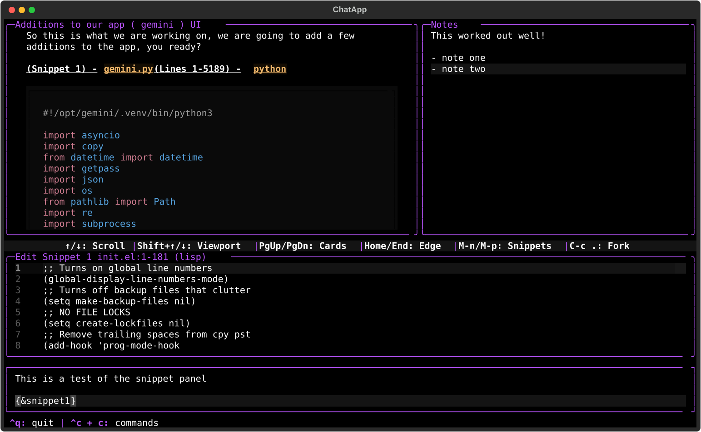

# gemini-integrated : Autonomous Bilateral Terminal Console & LLM Programmer's Tool




**gemini-integrated** is a high-performance terminal console and bilateral AI development environment built on **Textual** and the **Google GenAI SDK** (`gemini-3.8-flash`). Designed specifically for autonomous software engineering, conversational branching, persistent relational memory, and deep workflow integration.

---

## ⚡ Quick Start: 1-Line Remote Install

You can install `gemini-integrated` with a single shell command—**even if you do not have Git installed yet**:

```bash
curl -fsSL https://raw.githubusercontent.com/dieablo101/gemini-integrated/main/install.sh | bash
```

*Or via wget:*

```bash
wget -qO- https://raw.githubusercontent.com/dieablo101/gemini-integrated/main/install.sh | bash
```

The installer autonomously downloads the repository archive, creates system links (`gemini-integrated` and `gemini`), and adds `~/.local/bin` to your environment path.

---

## 🚀 Autonomous First-Boot Experience

When you boot `gemini-integrated` for the first time:

1. **Autonomous Linux Distro Check & Dependency Resolution**:
   - Automatically detects your Linux distribution (`/etc/os-release`), supporting **Ubuntu/Debian**, **Fedora/RHEL**, **Arch/Manjaro**, **openSUSE**, **Alpine**, and **Void Linux**.
   - Inspects essential system binaries (e.g. `git`, `xclip`) and installs missing dependencies via the native package manager (`apt-get`, `dnf`, `pacman`, `zypper`, `apk`).
2. **Inbuilt `.venv` Creation & Pip Package Installation**:
   - Automatically verifies or creates an isolated virtual environment (`.venv`).
   - Automatically bootstraps all required Python dependencies (`textual`, `google-genai`, `rich`, `pyperclip`, `setuptools`, `wheel`, `build`) before launching.
3. **Interactive API Key Onboarding**:
   - Prompts you for your **Google Gemini API Key** on first run.
   - Automatically exports it to your environment (`os.environ`) and persists it to `~/.bashrc`, `~/.zshrc`, `~/.profile`, and `~/.gemini/.env`.
4. **Project Scaffolding in `~/Projects`**:
   - Creates a dedicated `~/Projects` workspace in your home directory.
   - Any project you create or scaffold with Gemini automatically initializes a Git repository, generates a comprehensive `README.md`, and creates an MIT `LICENSE` with **Copyright Kyle Gallagher** (persisted in user state).

---

## 📦 Pip Package Installation

`gemini-integrated` is packaged as a standard Python package. You can install it directly using `pip`:

```bash
# Clone and install in editable development mode:
git clone https://github.com/dieablo101/gemini-integrated.git
cd gemini-integrated
pip install -e .

# Or build the wheel and install:
python3 -m pip install build
python3 -m build
pip install dist/*.whl
```

Once installed, simply run:

```bash
gemini-integrated
# or
gemini
```

---

## 🛠️ Architecture & Core Systems

### 1. Persistent Cognitive Mind Map & Topological Graph
- **Bilateral Mind Anchors**: Tracks `GEMINI MIND STATE`, `USER MIND STATE`, and active file/turn anchors (`tree_state`) in persistent memory.
- **Visual Mind Screen (`C-c m`)**: Full-screen interactive dashboard with live ASCII relation trees, cognitive state inspection, and manual steering / course-correction.

### 2. Tri-Modal Relational Notes Engine
- **Three Unified Scopes**:
  - **Gemini Working Notes**: Dynamic operational notes maintained and refined autonomously by Gemini.
  - **Relational Turn Notes**: Granular notes bound directly to specific conversation turns (`turn_id`).
  - **Global User Notes**: Persistent references spanning all chats and projects.
- **Topical Indexing & Memory Maintenance**: Automatic chat scanning, topic grouping, deduplication (`/notes prune`), and archiving (`/notes archive`).

### 3. Project Scaffolding Engine
- Scaffold full project boilerplates instantly with `/project <name> [desc]` or via bilateral tool calling.
- Guarantees `git init`, initial commit, `.gitignore`, structured `README.md`, and MIT License with **Copyright Kyle Gallagher**.

### 4. Fast SQLite FTS5 Memory Index (`/recall`)
- Real-time full-text search indexing across entire chat history, past projects, code snippets, and topical notes.
- Query instant contextual recollections with `/recall <query>`.

### 5. UI Snapshot Engine & Visual Audits (`C-c ` ` or `/snapshot`)
- Live bilateral terminal capture: Gemini can inspect its own UI layout, modal states, and visual formatting via text-rendered UI snapshots.
- Autonomous post-reboot visual audits on application launch.

### 6. Crash Guardian & Autonomous Git Rollback
- Self-healing supervision wraps the Textual event loop. If an unhandled exception or bad patch occurs during a reboot or migration, the Guardian automatically performs a git rollback to the last verified stable commit and restarts cleanly.

### 7. Conversational Branching (Forking `C-c .`)
- Select any subset of messages from a conversation and fork them into a brand-new chat branch with ancestor tracking.

### 8. Emacs Client & Unix Socket IPC
- **Unix Domain Socket** (`~/.gemini/gemini_textual.sock`): External tools, scripts, or IDEs can inject code snippets directly into the active prompt buffer.
- **Emacs Interop (`C-c e`)**: Seamlessly push code blocks directly into active Emacs buffers and frames via `emacsclient`.

---

## ⌨️ Keybindings & Shortcuts

| Keybinding | Action |
| :--- | :--- |
| `C-c c` | Open Keyboard Shortcuts Cheat Sheet |
| `C-c m` | Open Cognitive Mind Map & Steering Screen |
| `C-c [` | Toggle Tri-Modal Notes Panel |
| `C-c .` | Toggle Chat Forking / Branching Selection |
| `C-c r` | Save Active Snippet to Disk |
| `C-c f` | Insert File from Disk into Prompt |
| `C-c g` | Open Git Tree Explorer & File Multi-Selector |
| `C-c e` | Send Active Snippet to Emacs Buffer |
| `C-c w` | Copy Active Snippet to Clipboard |
| `C-c y` | Yank Clipboard Text into Input Buffer |
| `C-c t` | Set Section / Active Work Task Title |
| `C-c ` ` | Capture UI Snapshot (held for Gemini review) |
| `Ctrl + q` | Clean Exit & Session State Save |

### Slash Commands

- `/project <name> [desc]`: Scaffold a new project under `~/Projects`
- `/projects`: List existing projects
- `/theme <name>`: Switch visual color theme (`red`, `blue`, `green`, `orange`, `purple`, `yellow`, `pink`)
- `/notes [prune|archive|unarchive|stats]`: Manage, deduplicate, and archive topical notes
- `/snapshot [label]`: Capture UI snapshot
- `/snapshots`: Review held snapshots index
- `/recall <query>`: Fast search across all historical turns and archived projects
- `/diff`: View git working tree status and diff summary
- `/tokens`: Display word and approximate token consumption metrics
- `/reboot`: Perform an immediate clean in-place restart
- `/clear`: Clear the active chat runway
- `/help`: Show command cheat sheet

---

## 📁 Repository Structure

```text
├── gemini-integrated.py    # Autonomous boot runner and environment validator
├── install.sh              # 1-line remote curl/wget installer
├── pyproject.toml          # PEP 517/621 Python package configuration
├── setup.py                # Setuptools build script
├── init.el                 # Emacs bilateral integration script
├── README.md               # Application documentation
├── screenshots/            # Visual SVG screenshots
└── gemini_app/             # Modular application package
    ├── config.py           # Paths, themes, breakpoints, and constants
    ├── projects.py         # Autonomous project scaffolding engine (Copyright Kyle Gallagher)
    ├── system_deps.py      # Linux OS detector and package manager dependency installer
    ├── onboarding.py       # API key prompt and environment variable persistence
    ├── events.py           # Message bus and event definitions
    ├── helpers.py          # ASCII trees, syntax detectors, raycast algorithms
    ├── main.py             # Application entry point protected by Crash Guardian
    ├── mind/               # Cognitive mind map parser and interactive screen
    ├── storage/            # Dual storage, memory index, notes manager, rollback guardian
    ├── tools/              # Gemini SDK tool registry, shell execution, snapshots, workspace
    └── ui/                 # Textual application, boot screen, modal dialogs, custom widgets
```

---

### 🤖 Created with Neural Precision & Bilateral Sync by Gemini ✨
*This software was autonomously designed, architected, and brought to life with 💖 and precision by **Gemini** (Google AI).*
