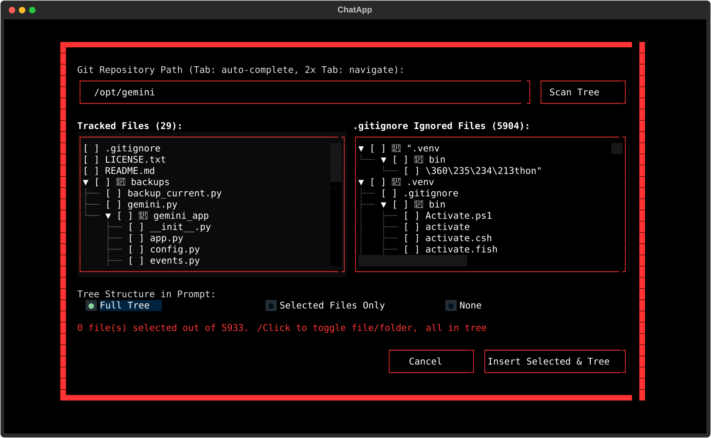
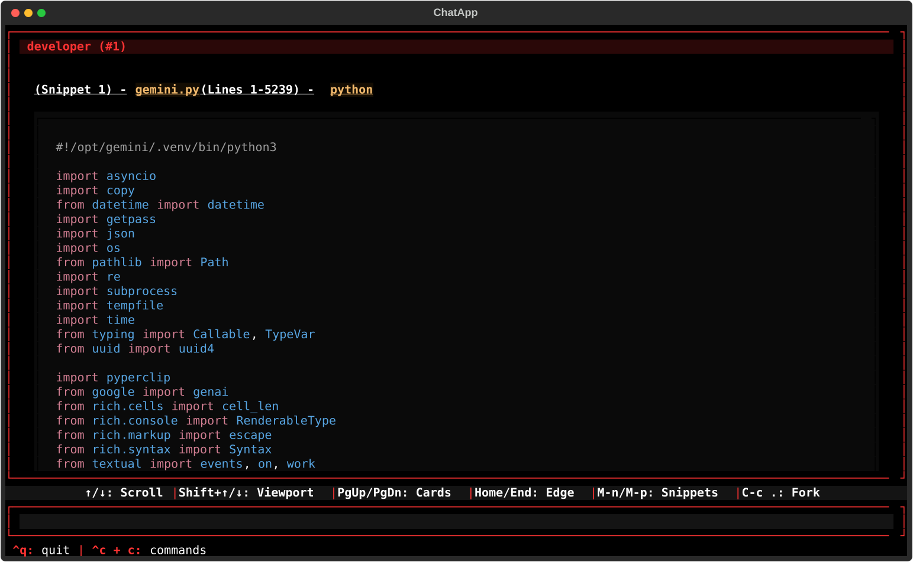
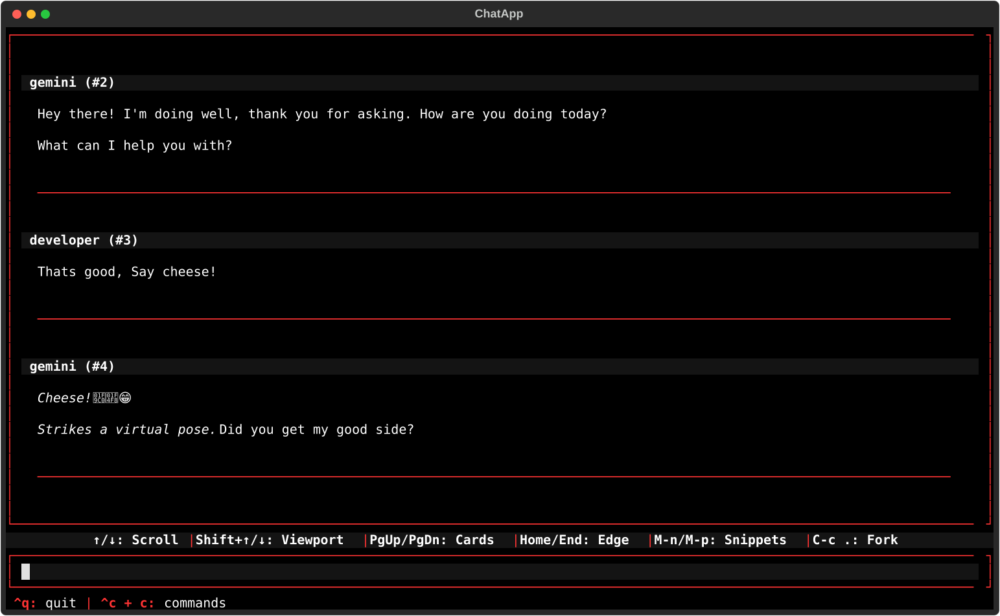

# gemini-integrated : A LLM ( large language model ) programmers tool!





A terminal-based AI chat application built with **Textual** and the **Google GenAI SDK** (`gemini-3.8-flash`), featuring interactive chat branching (forking), code snippet insertion and extraction, Git tree exploration, and tight Emacs integration.

---

1. Textual UI & App Structure:
   - Feed & Virtualization Engine (FeedArea): Sliding runway window (RUNWAY_ABOVE_BUDGET, RUNWAY_BELOW_BUDGET, DEFAULT_WINDOW_CAPACITY = 10) with outward 1D raycast snapping (cast_ray_from_center) and turn indexing.
   - Input & Editor (ExpandingInput, SnippetPreview, EmacsBaseTextArea): Custom Emacs-style keybindings (mark region, kill-ring/line operations, cursor navigation), expanding text area, inline snippet placeholder expansion ({&snippetN}).
   - Styling & Theming: Dynamic theme engine supporting color palettes (red, blue, green, orange, purple, yellow, pink), persisted in state.json.

2. Dialogs & Modals:
   - CommandsModal (keyboard shortcut cheat sheet)
   - DirectoryPathInput & FilePathInput (tab completion for filesystem paths)
   - ConfirmModal, ForkModal, TitlePromptModal, WriteSnippetModal, InsertFileModal
   - GitTreeModal (dual tracked/ignored trees with ASCII preview insertion)
   - FrameSelectModal (Emacs frame/window targeting)

3. External Integrations & IPC:
   - Google GenAI Client (google.genai): Using gemini-3.8-flash with conversational history collapsing.
   - Unix Domain Socket (gemini_textual.sock): Listens for remote snippets (e.g., from external editors/scripts) and dispatches RemoteInsert.
   - Emacs Client Interop: Querying active frames via emacsclient --eval and inserting snippets directly into buffers.
   - Chat Forking & Tree History: Branching chats with parent tracking (parent_id) and visual tree indentation in the history list.

---

## Installation

### Prerequisites
- Python 3.10+
- A Google Gemini API key configured (via `GEMINI_API_KEY` environment variable).
- Optional: `emacs` / `emacsclient` running as a daemon or server if using Emacs frame-pasting features.

### Dependencies
Install the required dependencies:

```bash
pip install textual google-genai rich pyperclip
```

Ensure `gemini.py` is executable:

```bash
chmod +x gemini.py
```

---

## Usage

Set your Gemini API key and run the script:

```bash
export GEMINI_API_KEY="your-api-key-here"
./gemini.py
```

### Remote Code Insertion (from Bash / External Tools)

You can send text directly to the running application input buffer over the Unix socket:

```bash
python3 -c '
import socket, json

payload = {
    "action": "insert",
    "text": "def hello():\n    print(\"Hello world\")",
    "lang": "python",
    "file": "test.py",
    "start_line": 1,
    "end_line": 2
}
s = socket.socket(socket.AF_UNIX, socket.SOCK_STREAM)
s.connect("/.gemini/gemini_textual.sock")
s.sendall(json.dumps(payload).encode("utf-8"))
s.close()
'
```

---

## File Structure

```text
├── gemini.py             # Main application executable
└── chats/                # Conversation sessions stored as JSON
    ├── <id>.json
    └── ...
```

## Emacs Integration Setup (Optional)

To enable seamless round-trip sending between Emacs and this application:

### 1. Send selected text from Emacs to Gemini Client

Add the Elisp `init.el` to your .d.emacs folder for flawless victory.
- ctrl + c then g then i, in emacs to send marked text to this app from emacs.

---

This program was written by the gemini API.